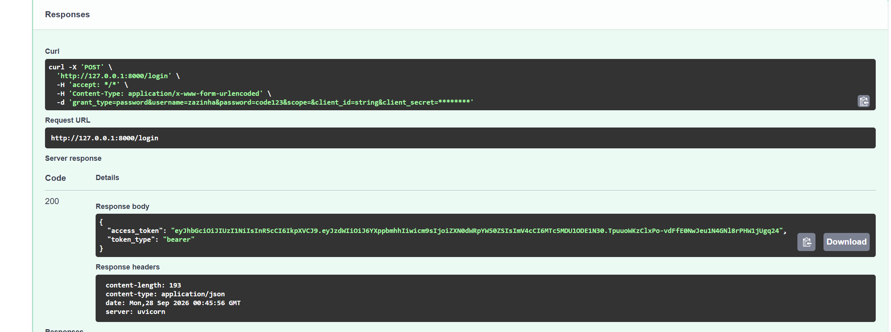
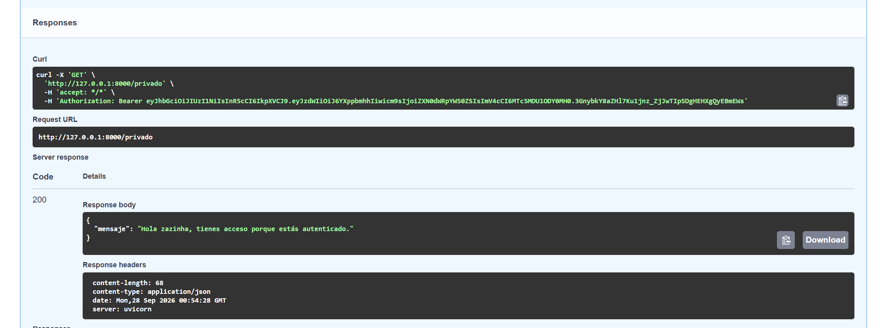
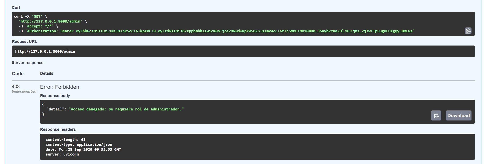

PARTE A — Conceptual (profeshola pongame 20 att: cartagena)

Pregunta 1: ¿Qué significa JWT y cuáles son sus tres partes?

JWT significa JSON Web Token. Es un estándar (RFC 7519) utilizado para transmitir información de forma segura entre partes como un objeto JSON. Está compuesto por tres partes separadas por puntos (.):

Header (Encabezado): Contiene el tipo de token (JWT) y el algoritmo de firma utilizado (como HMAC SHA256 o RSA)

Payload (Carga útil): Contiene los "claims" o declaraciones, que son los datos que se desean transmitir (ej. ID de usuario, rol, fecha de expiración)

Signature (Firma): Se crea combinando el Header y el Payload codificados, firmados con un algoritmo y un SECRET_KEY conocido solo por el servidor, para garantizar que el token no ha sido alterado en el camino

Pregunta 2: ¿Por qué el payload NO es seguro para guardar contraseñas?

El payload de un JWT no está encriptado, simplemente está codificado en formato Base64Url. Cualquier persona que intercepte o posea el token puede decodificarlo fácilmente pegándolo en herramientas como jwt.io y leer su contenido en texto plano. Guardar información sensible como contraseñas allí expondría las credenciales del usuario a cualquiera que tenga acceso al token

Preagunta 3: ¿Qué sucede si alguien modifica el payload sin conocer el SECRET_KEY?

La firma del token se invalida. Cuando el servidor recibe el token modificado, toma el nuevo Header y el nuevo Payload e intenta recalcular la firma utilizando su SECRET_KEY interno. Como el resultado generado no coincidirá con la firma que trae el token, el servidor lo rechazará, detectando que la información fue manipulada por un tercero

Pregunta 4: Diferencia entre 401 Unauthorized y 403 Forbidden. ¿Cuándo usa cada uno FastAPI?

401 Unauthorized: Significa que el cliente no está autenticado. El servidor no sabe quién es el usuario porque falta el token, es inválido o ha expirado. FastAPI lo lanza automáticamente (a través de dependencias como OAuth2PasswordBearer) cuando fallan las credenciales al intentar acceder a una ruta protegida

403 Forbidden: Significa que el cliente está autenticado, pero no está autorizado para realizar esa acción. El servidor sabe quién es el usuario (el token es válido), pero su nivel de acceso o rol es insuficiente. En FastAPI, debes lanzarlo manualmente mediante un HTTPException cuando, por ejemplo, un usuario con rol "estudiante" intenta acceder a una ruta exclusiva para "admin"

CAPTURAS!!!!

### 1. Autenticación y Generación de Token JWT (200 OK)

### 2. Acceso a Ruta Privada (200 OK)

### 3. Restricción de Acceso a Admin por Rol (403 Forbidden)

